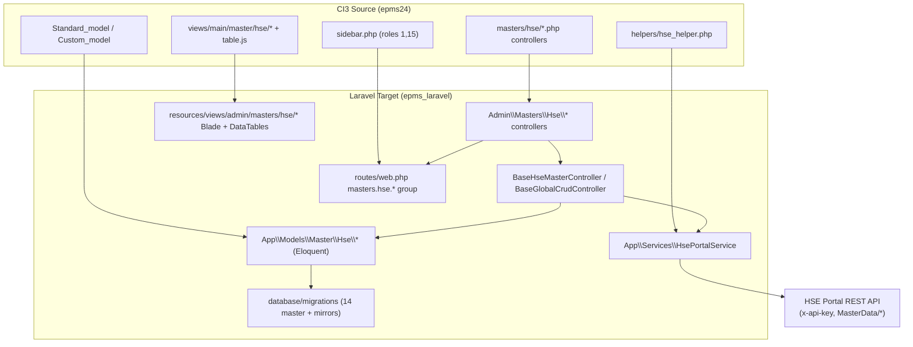
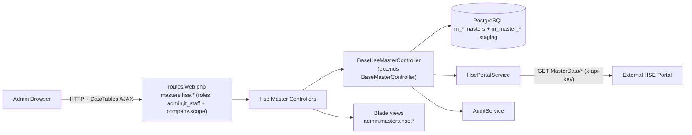
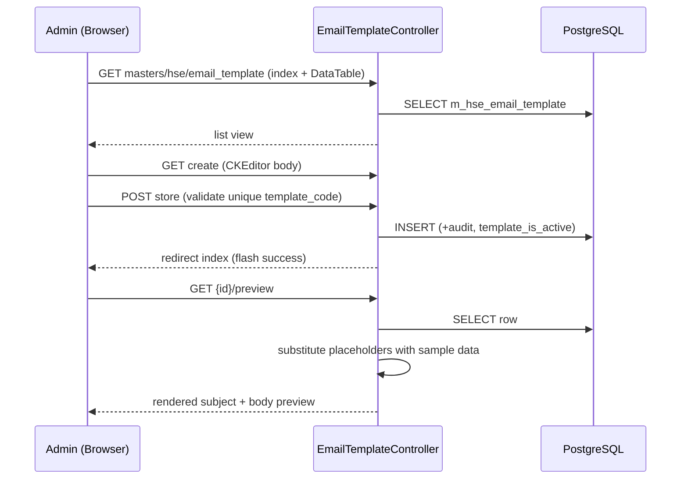

# Design Document: Master HSE (SHE) — Admin Role Migration

## Overview

This feature migrates the **Master HSE** (labelled "Master SHE" in the UI) module for the **Admin** role from the legacy CodeIgniter 3 app (`C:\xampp\htdocs\epms24`, branch `CR_HSE_2026`) to the Laravel app (`c:\laragon\www\epms_laravel`). It covers 14 HSE master sub-modules: Category of Injuries, Type of Injury, Type of Disease, Type of Accident, First Aid Kit, Process Location, Likelihood, Severity, Risk Priority Order, Course, Incident Time, HIRARC Template, Email Receiver, and Email Template.

The HSE masters split into two behavioural families that map cleanly onto patterns already present in the Laravel codebase:

1. **Portal-synced masters** (10 of 14) are **read-only from the UI** and populated from an external **HSE Portal REST API** (not SAP) through a three-step flow: *Get All Data From HSE* → *Refresh Master Data Info* → *Replace Master Data*, buffered through `m_master_*` staging mirror tables. This mirrors the existing Laravel `BaseMasterController` two-step SAP flow (`getFromSap` → `refreshFromMaster`), extended with an explicit "info/compare" step. Each also keeps the standard CSV upload + template download + DataTable + delete-with-confirmation behaviours.
2. **Full-CRUD masters** (2 of 14: Email Receiver, Email Template) are authored entirely in EPMS with no portal sync. These map onto the existing `BaseGlobalCrudController` pattern. Email Template additionally carries a CKEditor HTML body, placeholder tokens, and a preview page.

The design reuses the Laravel app's existing building blocks: `App\Http\Controllers\Admin\Masters\BaseMasterController` (index/datatable/CSV/sync scaffolding), `BaseGlobalCrudController` (global non-tenant CRUD), the Yajra DataTables + `SqlSrv` helpers under `app\Database\OdbcSqlSrv\DataTables`, the `App\Models\Master\*` Eloquent models, `AuditService`, and the role/middleware stack (`roles:...,admin,it_staff` + `company.scope`). A new `App\Services\HsePortalService` encapsulates the external HSE Portal HTTP contract, replacing the CI3 `application/helpers/hse_helper.php` functions `get_master_data_from_hse()` / `post_data_to_hse_api()`.

**Scope boundary.** This spec covers **Master HSE for the Admin role only**. HSE transactions (Accident Report, First Aid Kit Usage, HIRARC Draft, Medical Check, Incident Investigation, RCA), approval/closing workflows, training, and the mobile API are explicitly **out of scope**. The HIRARC Template master (sub-module 12) is in scope only for the *template staging + fetch* behaviour; its downstream "apply to `t_hirarc`" transaction behaviour is out of scope and is documented as a deferred integration point.

---

## Architecture

### Component mapping (CI3 → Laravel)



### Runtime layering



### Key architectural decisions

- **New `BaseHseMasterController`** extends the existing `BaseMasterController` and overrides the SAP-specific hooks with an HSE-Portal three-step flow. This keeps the shared index/datatable/CSV/export logic intact while isolating the portal protocol. Portal-synced masters subclass it; the two CRUD masters subclass `BaseGlobalCrudController`.
- **Global (non-tenant) scope.** The HSE master DDL has no `company_id` column (except estate/division references inside First Aid Kit). Reads therefore do **not** apply `company.scope`'s `where('company_id', ...)`. `baseQuery()` is overridden to drop company scoping — the same approach `BaseGlobalCrudController` already uses.
- **Separate HSE service, not `SapService`.** The portal uses a different transport (JSON over HTTP with `x-api-key` header, base URL `m_company_config.hse_api_url`, paginated `MasterData/*` endpoints) than SAP (XML, basic auth). A dedicated `HsePortalService` preserves the exact external contract from `hse_helper.php`.
- **Staging-backed replace with rollback.** The "Replace Master Data" step truncates the live master and batch-inserts from staging inside a DB transaction, restoring the prior snapshot on failure — faithful to the CI3 `replace_master_data()` rollback behaviour.
- **Route/name conventions** follow the existing `masters.*` group with an added `hse.` segment, e.g. `masters.hse.injuries_category.index`.

---

## Sequence Diagrams

### Portal sync: Get → Refresh (info) → Replace

```mermaid
sequenceDiagram
    participant A as Admin (Browser)
    participant C as HseMasterController
    participant S as HsePortalService
    participant P as HSE Portal API
    participant DB as PostgreSQL

    Note over A,DB: STEP 1 — Get All Data From HSE
    A->>C: POST masters/hse/{m}/get-from-hse
    C->>S: fetchMasterData(endpoint)
    S->>P: GET MasterData/{resource}?pageNumber=1&pageSize=200 (x-api-key)
    P-->>S: 200 JSON (array or {items:[...]})
    S-->>C: normalized rows
    C->>DB: TRUNCATE m_master_{m}; batch INSERT staging
    C-->>A: JSON success + staging count

    Note over A,DB: STEP 2 — Refresh Master Data Info (compare)
    A->>C: GET masters/hse/{m}/staging-info
    C->>DB: COUNT(current) , COUNT(staging)
    C-->>A: {current_rows, new_rows}

    Note over A,DB: STEP 3 — Replace Master Data
    A->>C: POST masters/hse/{m}/replace-from-staging
    C->>DB: BEGIN
    C->>DB: snapshot current -> memory; DELETE master; batch INSERT from staging (+audit)
    alt inserted == staging count
        C->>DB: COMMIT
        C-->>A: success (N records)
    else mismatch / error
        C->>DB: ROLLBACK (restore snapshot)
        C-->>A: error (transaction rolled back)
    end
```

### Full CRUD (Email Template with preview)



---

## Components and Interfaces

### Component 1: `BaseHseMasterController` (new, abstract)

**Purpose**: Shared base for the 10 portal-synced HSE masters. Extends `App\Http\Controllers\Admin\Masters\BaseMasterController`, reuses its `index`, `getDatatable`, `upload`, `preview`, `saveUploadedData`, `cancelUpload`, `exportMasterData`, `generateCsv`, and overrides the sync pipeline for the HSE Portal.

**Interface** (PHP method signatures):

```php
abstract class BaseHseMasterController extends BaseMasterController
{
    // ── HSE-specific contract each child must define ──
    /** HSE Portal endpoint path, e.g. 'MasterData/category-of-injuries' */
    abstract protected function hseEndpoint(): string;

    /** Staging mirror table, e.g. 'm_master_category_of_injuries' */
    abstract protected function stagingTable(): string;

    /** Map one portal JSON item -> staging row (portal field names -> staging columns) */
    abstract protected function mapPortalItem(array $item): array;

    /** Columns copied staging -> master during Replace (staging col => master col) */
    abstract protected function stagingToMasterMap(): array;

    // ── Overridden base scoping ──
    protected function baseQuery();                 // drops company_id scope (global)
    protected function sapConfig(): ?array;         // returns null (disables SAP flow)

    // ── Three-step HSE Portal flow ──
    public function getFromHse(): JsonResponse;     // STEP 1: portal -> staging (truncate+insert)
    public function stagingInfo(): JsonResponse;    // STEP 2: {current_rows, new_rows}
    public function replaceFromStaging(): RedirectResponse; // STEP 3: staging -> master (tx + rollback)

    // ── Hooks ──
    protected function masterKeyColumn(): string;   // natural key for dedupe/ordering
    protected function addAuditFields(array $row): array; // created_by/created_date injection
    protected function usesManualIdentityKey(): bool;  // true for identity-keyed masters needing COALESCE(MAX(id),0)+1
}
```

**Responsibilities**:
- Translate portal responses into staging rows via `mapPortalItem`.
- Enforce the truncate-then-insert staging contract and the transactional replace-with-rollback contract.
- Emit `AuditService` entries for fetch and replace operations.
- Leave CSV import/export and DataTable rendering to the inherited base.
- For identity-keyed masters (`usesManualIdentityKey()` returns `true`), complement `addAuditFields()` with a manual id-assignment step during Replace: because the HSE Portal source does not supply database-generated `id` defaults, each inserted row is assigned a sequential integer id starting at `COALESCE(MAX(id),0)+1`.

### Component 2: Concrete portal-synced controllers (10)

Each is a thin subclass of `BaseHseMasterController` declaring its table, resource name, datatable columns, CSV headers, portal endpoint, staging table, and field mappings. They live under `app\Http\Controllers\Admin\Masters\Hse\`.

| Controller | Master table | Staging mirror | Portal endpoint |
|---|---|---|---|
| `InjuriesCategoryController` | `m_category_of_injuries` | `m_master_category_of_injuries` | `MasterData/category-of-injuries` |
| `InjuriesTypeController` | `m_type_of_injury` | `m_master_type_of_injury` | `MasterData/type-of-injuries` |
| `DiseaseTypeController` | `m_type_of_disease` | `m_master_type_of_disease` | `MasterData/type-of-diseases` |
| `AccidentTypeController` | `m_type_of_accident` | `m_master_type_of_accident` | `MasterData/type-of-accidents` |
| `FirstAidKitController` | `m_first_aid_kit` | `m_master_first_aid_kit` | `MasterData/first-aid-kits` |
| `ProcessLocationController` | `m_process_location` | `m_master_process_location` | `MasterData/process-locations` |
| `LikelihoodController` | `m_likelihood` | `m_master_likelihood` | `MasterData/likelihoods` |
| `SeverityController` | `m_severity` | `m_master_severity` | `MasterData/severities` |
| `RiskPriorityOrderController` | `m_risk_priority_order` | `m_master_risk_priority_order` | `MasterData/risk-acceptabilities` |
| `CourseController` | `m_course` | `m_master_course` | `training-courses/all` |

> **Portal endpoints and field names — VERIFIED** against the live HSE Portal (base `http://ec2-15-232-111-191.ap-southeast-3.compute.amazonaws.com/hse-api/api`) and its Swagger (`.../hse-api/swagger/v1/swagger.json`). Every `MasterData/*` endpoint returns a **top-level JSON array** (no `{items:[...]}` envelope) and accepts `?pageNumber=N&pageSize=M`. Fields are **camelCase**. Verified field lists per endpoint:
>
> - `MasterData/category-of-injuries` → `id, code, name, acronym, injuryType, isActive, createdDate, modifiedDate`. **Mapping decision:** `acronym` has **no** column in the `m_master_category_of_injuries` mirror and is currently **dropped** on sync (`code→category_injuries_code`, `name→category_injuries`, `injuryType→injuries_type`).
> - `MasterData/type-of-injuries` → `id, code, injuryName, afrCode, afrJkkpName, benchmarkEsgName, isActive, createdDate, modifiedDate`.
> - `MasterData/type-of-diseases` → `id, code, diseaseName, diseaseCategory, afrCode, afrJkkpName, benchmarkName, isActive, createdDate, modifiedDate`.
> - `MasterData/type-of-accidents` → `id, code, accidentName, afrJkkpName, afrCode, isActive, createdDate, modifiedDate`.
> - `MasterData/first-aid-kits` → `id, code, kitName, uom, isActive, createdDate, modifiedDate`. **Note:** the portal does **not** return `estate_code`/`division_code`; those master columns stay `null` on sync.
> - `MasterData/process-locations` → `id, code, description, status, revNo, isActive, createdDate, modifiedDate` (`code→ploc_id`, `description→ploc_desc`, `status→ploc_status`, `revNo→ploc_rev_no`).
> - `MasterData/likelihoods` → `id, code, name, description, factors, justification, rating, isActive, createdDate, modifiedDate` (`code→lhood_code`, `name→lhood_name`, `description→lhood_description`, `factors→lhood_factors`, `justification→lhood_justification`, `rating→lhood_rating`).
> - `MasterData/severities` → `id, code, severityName, rating, isActive, createdDate, modifiedDate` (`code→severity_code`, `severityName→severity_name`, `rating→severity_rating`).
>
> **Endpoint corrections (earlier guesses were wrong):**
> - **Risk Priority Order** → correct endpoint is `MasterData/risk-acceptabilities` (the earlier `MasterData/risk-priority-orders` **404s**). Verified fields: `id, minValue, maxValue, riskLevel, riskAcceptability, actionDescription, isActive, createdDate, modifiedDate`. This differs substantially from the `m_master_risk_priority_order` mirror (`risk_acceptability_name, risk_order, risk_range_lower, risk_range_upper`). **Mapping must reconcile:** suggested `riskAcceptability→risk_acceptability_name`, `riskLevel`/`id`→`risk_order` (**needs decision** — exact `risk_order` source is an implementation decision), `minValue→risk_range_lower`, `maxValue→risk_range_upper`; `actionDescription` has **no** mirror column.
> - **Course** → there is **no** `MasterData/courses` endpoint. Training courses live under a **different base path**: `/api/training-courses/all` (also `/published`, `/by-epms/{courseNoEpms}`, `/by-no/{courseNo}`). `CourseController::hseEndpoint()` therefore targets `training-courses/all`, a **non-`MasterData/`** path, so `HsePortalService` must support endpoints outside `MasterData/`.
>
> The dual-shape handling (array OR `{items:[...]}`) is retained defensively, but the live portal uses a top-level array.

### Component 3: `IncidentTimeController` (CRUD + CSV — confirmed)

`m_incident_time` is a tiny lookup keyed by `incident_time_name`. CI3 exposes it under Master SHE. It has no `m_master_incident_time` mirror in the DDL, and the live HSE Portal exposes **no** incident-time endpoint (verified against Swagger). It is therefore **CRUD + CSV** (subclass `BaseGlobalCrudController` with CSV mixin) — confirmed, not a portal-synced master.

### Component 4: `HirarcTemplateController` (staging-fetch only, in scope)

**Purpose**: Fetch HIRARC templates from the portal into the `zhse_hirarc_template` staging table and display a compare view (staging vs current). The portal exposes HIRARC under a dedicated base path (verified): `/api/hirarc`, `/api/hirarc/all`, `/api/hirarc/published`, `/api/hirarc/requested`, `/api/hirarc/{code}`. `getTemplate` targets `/api/hirarc/all` (or `/published`), **not** a `MasterData/*` path. The downstream `apply_template()` behaviour (writing into `t_hirarc` and children) is a **transaction** and is **out of scope**; this controller exposes only `index`, `getTemplate` (fetch to staging), and `refreshInfo` (count compare). The "Apply" action is stubbed/disabled with a note pointing to the deferred HIRARC transaction spec.

**Interface**:

```php
class HirarcTemplateController extends BaseController
{
    public function index();            // staging (zhse_hirarc_template) + current (t_hirarc) compare view
    public function getTemplate(): RedirectResponse;  // GET hirarc?pageNumber=1&pageSize=200 -> truncate+insert staging
    public function refreshInfo(): JsonResponse;      // {current_rows, new_rows}
    // applyTemplate() intentionally deferred (out of scope — HIRARC transaction)
}
```

### Component 5: `EmailReceiverController` + `EmailTemplateController` (full CRUD)

**Purpose**: EPMS-authored masters with no portal sync. Subclass `BaseGlobalCrudController`.

- `EmailReceiverController`: fields `receiver_name`, `receiver_email`, `receiver_level`, `receiver_department`, `receiver_notification_type` (default `All`), `receiver_is_active`. Select2 dropdowns for level/department/notification type (static option sets preserved from CI3). Duplicate guard on `(receiver_email, receiver_notification_type)`.
- `EmailTemplateController`: fields `template_code` (unique), `template_name`, `template_subject`, `template_body` (CKEditor HTML), `template_is_active`. Adds a `preview($id)` action that substitutes placeholder tokens (`{estate_code}`, `{date}`, `{employee_code}`, `{description}`, `{severity}`, etc.) with sample values and renders subject/body.

**Interface**:

```php
class EmailTemplateController extends BaseGlobalCrudController
{
    public function index();
    public function getDatatable(Request $r): JsonResponse;
    public function create();
    public function store(Request $r): RedirectResponse;   // inherited + unique template_code
    public function edit(int $id);
    public function update(Request $r, int $id): RedirectResponse;
    public function destroy(int $id): RedirectResponse;
    public function preview(int $id);                      // placeholder substitution
    protected function placeholderSamples(): array;        // token => sample value
}
```

### Component 6: `HsePortalService` (new)

**Purpose**: Encapsulate the HSE Portal HTTP contract, replacing `hse_helper.php`.

**Interface**:

```php
class HsePortalService
{
    public function __construct(private string $baseUrl, private string $apiKey) {}
    public static function fromConfig(): self;   // resolves current company's CompanyConfig and reads m_company_config.hse_api_url + static api key

    /** GET {baseUrl}/{endpoint}; returns ['data'=>array|string,'status_code'=>int] */
    public function get(string $endpoint): array;

    /** POST {baseUrl}/{endpoint} with JSON body; returns ['data'=>..., 'status_code'=>int] */
    public function post(string $endpoint, array $body = []): array;

    /** Convenience: GET a paginated MasterData resource, returns normalized item array */
    public function fetchMasterData(string $endpoint, int $pageSize = 200): array;
}
```

**Preserved external contract** (from `hse_helper.php`, verified):
- Header: `Content-Type: application/json`, `x-api-key: <configured key>`.
- `CURLOPT_SSL_VERIFYPEER=false`, `CURLOPT_SSL_VERIFYHOST=false`, `CURLOPT_TIMEOUT=30`.
- Base URL from `m_company_config.hse_api_url`, accessed via the `App\Models\Global\CompanyConfig` model as `$config->hse_api_url` (seeded by `CR_HSE_2026.txt`; e.g. `http://.../hse-api/api`), trailing slash trimmed. The CI3 global single-row `m_config` table was redesigned in the Laravel target app into `m_company_config` (one row per company); this mirrors the existing SAP `sap_api_url` pattern read from the same model. `HsePortalService::fromConfig()` resolves the current company's `CompanyConfig` (the same way `SapService` obtains its `CompanyConfig`) to read `hse_api_url`; the API key remains application/environment-configured (`HSE_Portal_Api_Key`), unchanged.
- Response: HTTP 200 → `json_decode(...)` into array; otherwise raw body returned with status code.
- Implemented with Laravel's `Http` client (configured with the same headers/TLS/timeout) rather than raw cURL, preserving behaviour.

**HSE Portal — verified contract:**
- Base URL: `http://ec2-15-232-111-191.ap-southeast-3.compute.amazonaws.com/hse-api/api` (stored in `m_company_config.hse_api_url`, read via `CompanyConfig` as `$config->hse_api_url`).
- Swagger: `http://ec2-15-232-111-191.ap-southeast-3.compute.amazonaws.com/hse-api/swagger/v1/swagger.json`.
- Response shape: **top-level JSON array** for all master resources (no `{items:[...]}` envelope).
- Pagination: `?pageNumber=N&pageSize=M`.
- Endpoints span **three path roots**: `MasterData/*` (the 8 portal-synced masters above), `training-courses/*` (Course), and `hirarc/*` (HIRARC template). `HsePortalService` therefore must accept endpoint paths that are **not** rooted at `MasterData/`.
- **Also available but OUT OF SCOPE** for this feature (no controllers added): `MasterData/risk-matrices`, `MasterData/operation-units`, `MasterData/locations`, and the bulk `MasterData/all`.

---

## Data Models

All HSE master tables are **global** (no `company_id`) and created via Laravel migrations matching the PostgreSQL DDL in `CR_HSE_2026.txt`. Eloquent models live under `App\Models\Master\Hse\` (no `HasCompanyScope`).

### Portal-synced master tables

> **Manual identity-key note.** Five of these masters are keyed by an integer `id` for which the HSE Portal source supplies **no** database-generated identity default: `m_category_of_injuries`, `m_type_of_injury`, `m_type_of_disease`, `m_type_of_accident`, and `m_first_aid_kit`. Their controllers return `true` from `usesManualIdentityKey()`, so the Replace step assigns each inserted row a sequential `id` starting at `COALESCE(MAX(id),0)+1` (see "Replace Master Data (STEP 3)"). The remaining masters are keyed by a natural/business key (`m_process_location.ploc_id`, `m_risk_priority_order.risk_acceptability_name`, `m_course.course_no_epms`, `m_incident_time.incident_time_name`, `m_likelihood.lhood_id`, `m_severity.id` which carries its own sequence) and do **not** need manual id assignment.

```php
// m_category_of_injuries  (PK id identity)
['id','category_injuries_code','category_injuries','injuries_type',
 'created_by','created_date','updated_by','updated_date','deleted_by','deleted_date']

// m_type_of_injury (PK id)
['id','type_injury_code','injury_name','afr_code','afr_jkkp_name','benchmark_esg_name', ...audit]

// m_type_of_disease (PK id)  — note created_by is varchar in source
['id','disease_code','disease_name','disease_category','afr_code','afr_jkkp_name','benchmark_name', ...audit]

// m_type_of_accident (PK id)
['id','accident_code','accident_name','afr_jkkp_name','afr_code', ...audit]

// m_first_aid_kit (PK id) — has is_active, estate_code, division_code, uom
['id','kit_code','kit_name','uom','estate_code','division_code','is_active', ...audit]

// m_process_location (PK ploc_id varchar)
['ploc_id','ploc_desc','ploc_status','ploc_rev_no',
 'ploc_created_timestamp','ploc_created_by','ploc_updated_timestamp','ploc_updated_by']

// m_likelihood (PK lhood_id) — has is_active
['lhood_id','lhood_name','lhood_description','lhood_factors','lhood_justification',
 'lhood_code','lhood_rating','is_active', ...lhood_*_timestamp/by]

// m_severity (PK id, seq default)
['id','severity_code','severity_name','severity_rating','description',
 'severity_created_timestamp','severity_created_by','severity_updated_timestamp','severity_updated_by']

// m_risk_priority_order (PK risk_acceptability_name)
['risk_acceptability_name','risk_order','risk_range_lower','risk_range_upper', ...risk_*_timestamp/by]

// m_course (PK course_no_epms) — wide table incl. sync columns
['course_no_epms','course_no','course_estate_code','course_name','course_desc','course_category',
 'course_validity_from','course_validity_to','course_duration','course_type',
 'course_sync_status','course_hse_portal_id', ...]

// m_incident_time (PK incident_time_name)
['incident_time_name','incident_time_created_timestamp','incident_time_created_by',
 'incident_time_updated_timestamp','incident_time_updated_by']
```

### Staging mirror tables (data-only, no audit/PK)

The mirrors intentionally hold only the business columns (no audit, no identity), matching `CR_HSE_2026.txt`. Note that some mirrors use **different, portal-shaped column names** than their master (e.g. `m_master_severity(severity_code, severity_name, description, severity_rating)` vs master `m_severity`; `m_master_likelihood(likelihood_code, likelihood_name, likelihood_rating, description)` vs master `m_likelihood(lhood_*)`; `m_master_process_location(process_location_code, process_location_name, description)` vs master `m_process_location(ploc_*)`). The per-controller `stagingToMasterMap()` resolves these renames during Replace.

```php
// m_master_category_of_injuries: category_injuries_code, category_injuries, injuries_type
// m_master_type_of_injury:       type_injury_code, injury_name, afr_code, afr_jkkp_name, benchmark_esg_name
// m_master_type_of_disease:      disease_code, disease_name, disease_category, afr_code, afr_jkkp_name, benchmark_name
// m_master_type_of_accident:     accident_code, accident_name, afr_jkkp_name, afr_code
// m_master_first_aid_kit:        kit_code, kit_name, uom
// m_master_process_location:     process_location_code, process_location_name, description
// m_master_likelihood:           likelihood_code, likelihood_name, likelihood_rating, description
// m_master_severity:             severity_code, severity_name, description, severity_rating
// m_master_risk_priority_order:  risk_acceptability_name, risk_order, risk_range_lower, risk_range_upper
//   VERIFIED portal (MasterData/risk-acceptabilities) returns: id, minValue, maxValue, riskLevel,
//   riskAcceptability, actionDescription. Reconcile: riskAcceptability->risk_acceptability_name,
//   minValue->risk_range_lower, maxValue->risk_range_upper; risk_order source (riskLevel vs id)
//   is an implementation decision; actionDescription has NO mirror column.
// m_master_course:               course_code, course_name, course_category, duration, duration_unit,
//                                validity_from, validity_to, course_type, trainer_name
```

### Full-CRUD tables

```php
// m_hse_email_receiver (PK id seq)
['id','receiver_name','receiver_email','receiver_level','receiver_department',
 'receiver_notification_type' /*default All*/,'receiver_is_active' /*default 1*/,
 'created_by','created_date','updated_by','updated_date']

// m_hse_email_template (PK id seq, UNIQUE template_code)
['id','template_code','template_name','template_subject','template_body' /*HTML*/,
 'template_is_active' /*default 1*/,'created_by','created_date','updated_by','updated_date']
```

### HIRARC template staging

```php
// zhse_hirarc_template (data-only, jsonb snapshots)
['hirarc_no','hirarc_rev_no','hirarc_rev_date','hirarc_ops_center_code','hirarc_ploc_id',
 'hirarc_approved_by','hirarc_approved_by_designation','hirarc_remark','portal_status',
 'representatives_snapshot' /*jsonb*/,'details_snapshot' /*jsonb*/]
```

### Shared config column

```php
// m_company_config  ADD COLUMN hse_api_url varchar(500)   (seeded in CR_HSE_2026.txt / db_update_2026.txt)
// CI3 global single-row m_config was redesigned to m_company_config (one row per company); exposed via App\Models\Global\CompanyConfig $fillable as $config->hse_api_url, mirroring the existing SAP $config->sap_api_url pattern
```

**Validation rules (representative)**:
- Email Receiver: `receiver_name` required; `receiver_email` required + valid email; `receiver_level`, `receiver_department` required; unique `(receiver_email, receiver_notification_type)`.
- Email Template: `template_code` required + unique; `template_name`, `template_subject`, `template_body` required.
- Portal-synced masters via CSV: natural key (e.g. `category_injuries_code`) required and non-empty; rows deduped before insert (CI3 dedupes via serialize/unique).

---

## Key Functions with Formal Specifications

### `BaseHseMasterController::getFromHse()`

```php
public function getFromHse(): JsonResponse
```

**Preconditions:**
- Caller is authenticated and authorized (`roles:...,admin,it_staff`).
- `hseEndpoint()` and `stagingTable()` are defined by the subclass.
- `m_company_config.hse_api_url` is set.

**Postconditions:**
- On portal HTTP 200 with a non-empty normalized array: `stagingTable()` is truncated and re-populated with `mapPortalItem()`-mapped rows; returns JSON success with the new staging count; an `AuditService` UPDATE entry is written.
- On HTTP ≠ 200 or empty payload: no table mutation; returns JSON error describing the HTTP status or empty result.
- Never mutates the live master table.

**Loop invariant** (mapping loop over portal items): every processed item has been appended to the staging insert buffer with keys restricted to `stagingTable()`'s columns.

### `BaseHseMasterController::stagingInfo()`

```php
public function stagingInfo(): JsonResponse
```

**Preconditions:** subclass defines `tableName()` and `stagingTable()`.
**Postconditions:** returns `{current_rows: COUNT(master), new_rows: COUNT(staging)}`; read-only, no side effects.

### `BaseHseMasterController::replaceFromStaging()`

```php
public function replaceFromStaging(): RedirectResponse
```

**Preconditions:**
- `stagingTable()` is non-empty (else returns an error prompting to run Get first).
- Caller authorized; system not locked for non-privileged roles.

**Postconditions:**
- On success: the live master is replaced with staging rows (translated via `stagingToMasterMap()` + audit fields), inside one DB transaction; flash success with inserted count; audit entry written.
- For identity-keyed masters (`usesManualIdentityKey()` is `true`), every inserted row has a non-null, unique integer `id` assigned sequentially starting at `COALESCE(MAX(id),0)+1`.
- On any failure or count mismatch: the transaction is rolled back and the master retains its pre-operation contents (CI3 restores from an in-memory snapshot); flash error indicating rollback.
- Staging table is left intact (idempotent re-runs allowed).

**Loop invariants** (replace loop): (1) after each staging row is processed, the running `inserted` counter equals the number of rows written; (2) each written row contains all mapped master columns plus audit fields; (3) for identity-keyed masters, the `next_id` counter is strictly greater than every `id` already assigned in this run.

### `HsePortalService::fetchMasterData()`

```php
public function fetchMasterData(string $endpoint, int $pageSize = 200): array
```

**Preconditions:** `endpoint` non-empty; `baseUrl` and `apiKey` set.
**Postconditions:** returns a flat PHP array of items. The live portal returns a **top-level JSON array** (verified); the method additionally tolerates a `{ "items": [...] }` envelope defensively. On non-200, returns an empty array and the caller treats it as a fetch error. No side effects.

### `EmailTemplateController::preview()`

```php
public function preview(int $id)
```

**Preconditions:** template `id` exists.
**Postconditions:** returns a view with `subject`/`body` where every known placeholder token has been replaced by a sample value; the stored template row is unchanged.

---

## Algorithmic Pseudocode

### Get All Data From HSE (STEP 1)

```pascal
ALGORITHM getFromHse()
BEGIN
    ASSERT authorized() AND hseEndpoint() <> ''

    response <- HsePortalService.get(hseEndpoint())      // adds x-api-key, pagination
    IF response.status_code <> 200 THEN
        RETURN jsonError("Error requesting master data from HSE Portal (HTTP " + status + ")")
    END IF

    items <- normalize(response.data)                    // array OR {items:[...]}
    IF isEmpty(items) THEN
        RETURN jsonError("Master data invalid / not available from HSE Portal")
    END IF

    staging_rows <- []
    FOR each item IN items DO
        staging_rows.add( mapPortalItem(item) )          // portal fields -> staging columns
    END FOR

    TRANSACTION
        TRUNCATE stagingTable()
        BATCH INSERT staging_rows INTO stagingTable()
    END TRANSACTION

    AuditService.log(MASTER, UPDATE, "Fetched " + count(items) + " rows into staging")
    RETURN jsonSuccess(count(items) + " rows fetched into staging", stagingCounts())
END
```

### Replace Master Data (STEP 3) — with rollback

```pascal
ALGORITHM replaceFromStaging()
BEGIN
    ASSERT authorized() AND NOT lockedForRole()

    staging <- SELECT * FROM stagingTable()
    IF isEmpty(staging) THEN
        RETURN redirectError("No staged data. Click 'Get All Data From HSE' first.")
    END IF

    old_master <- SELECT * FROM tableName()              // in-memory snapshot for rollback

    TRY
        inserted <- 0
        TRANSACTION
            DELETE FROM tableName()
            // Identity-keyed masters: the portal source supplies no id default, so EPMS
            // computes the id manually. Computed AFTER the DELETE to mirror CI3's MAX(id)
            // on the live table; for a full replace the table is empty so this starts at 1,
            // but the COALESCE(MAX(id),0)+1 formula is preserved for fidelity and for any
            // partial/append scenario.
            IF usesManualIdentityKey() THEN
                next_id <- (SELECT COALESCE(MAX(id),0)+1 FROM tableName())
            END IF
            FOR each s IN staging DO
                ASSERT inserted = rowsWrittenSoFar       // loop invariant
                m <- {}
                FOR each (stagingCol, masterCol) IN stagingToMasterMap() DO
                    m[masterCol] <- s[stagingCol]
                END FOR
                m <- addAuditFields(m)                   // created_by, created_date
                IF usesManualIdentityKey() THEN
                    m["id"]  <- next_id
                    next_id  <- next_id + 1
                END IF
                INSERT m INTO tableName()
                inserted <- inserted + 1
            END FOR
            IF inserted <> count(staging) THEN RAISE mismatch
            touchLog(last_updated_at = now)
        COMMIT

        AuditService.log(MASTER, UPDATE, "Replaced master from staging (" + inserted + " rows)")
        RETURN redirectSuccess(inserted + " records refreshed from HSE staging")
    CATCH e
        ROLLBACK                                         // DB restores master; snapshot available as fallback
        RETURN redirectError("Replace failed, transaction rolled back: " + e.message)
    END TRY
END
```

### Email Template preview substitution

```pascal
ALGORITHM preview(id)
BEGIN
    row <- FIND m_hse_email_template WHERE id = id
    IF row = NULL THEN RETURN redirectError("Template not found")

    samples <- placeholderSamples()                      // {token -> sample value}
    subject <- replaceAll(row.template_subject, keys(samples), values(samples))
    body    <- replaceAll(row.template_body,    keys(samples), values(samples))

    RETURN view("admin.masters.hse.email_template.preview", {row, subject, body})
END
```

---

## Example Usage

```php
// routes/web.php — inside the existing masters.* group
// (middleware roles:...,admin,it_staff + company.scope; hse. name segment)
Route::prefix('hse')->name('hse.')->group(function () use ($hseMasterRoutes, $crudRoutes) {

    // Portal-synced master (Category of Injuries)
    Route::prefix('injuries_category')->name('injuries_category.')->group(function () use ($hseMasterRoutes) {
        $hseMasterRoutes('injuries_category', InjuriesCategoryController::class);
    });
    // ... repeat for the other 9 portal-synced masters ...

    // HIRARC template (fetch-to-staging only)
    Route::prefix('hirarc_template')->name('hirarc_template.')->group(function () {
        Route::get('/',             [HirarcTemplateController::class, 'index'])->name('index');
        Route::post('/get-template',[HirarcTemplateController::class, 'getTemplate'])->name('get-template');
        Route::get('/refresh-info', [HirarcTemplateController::class, 'refreshInfo'])->name('refresh-info');
    });

    // Full CRUD masters
    Route::prefix('email_receiver')->name('email_receiver.')->group(fn() => $crudRoutes(EmailReceiverController::class));
    Route::prefix('email_template')->name('email_template.')->group(function () use ($crudRoutes) {
        Route::get('/{id}/preview', [EmailTemplateController::class, 'preview'])->name('preview');
        $crudRoutes(EmailTemplateController::class);
    });
});
```

```php
// $hseMasterRoutes macro — mirrors $masterRoutes but swaps the SAP step for the HSE three-step flow
$hseMasterRoutes = function (string $prefix, string $controller) {
    Route::get('/',                      [$controller, 'index'])->name('index');
    Route::get('/datatable',             [$controller, 'getDatatable'])->name('datatable');
    Route::get('/upload',                [$controller, 'upload'])->name('upload');
    Route::post('/preview',              [$controller, 'preview'])->name('preview');
    Route::post('/save-uploaded-data',   [$controller, 'saveUploadedData'])->name('save-uploaded-data');
    Route::get('/cancel',                [$controller, 'cancelUpload'])->name('cancel');
    // HSE Portal three-step flow
    Route::post('/get-from-hse',         [$controller, 'getFromHse'])->name('get-from-hse');
    Route::get('/staging-info',          [$controller, 'stagingInfo'])->name('staging-info');
    Route::post('/replace-from-staging', [$controller, 'replaceFromStaging'])->name('replace-from-staging');
    // CSV
    Route::get('/export',                [$controller, 'exportMasterData'])->name('export');
    Route::get('/generate-csv',          [$controller, 'generateCsv'])->name('generate-csv');
};
```

```php
// Concrete controller example
class InjuriesCategoryController extends BaseHseMasterController
{
    protected function modelClass(): string   { return \App\Models\Master\Hse\CategoryOfInjuries::class; }
    protected function tableName(): string    { return 'm_category_of_injuries'; }
    protected function stagingTable(): string { return 'm_master_category_of_injuries'; }
    protected function resourceName(): string { return 'Category of Injuries'; }
    protected function viewPrefix(): string   { return 'admin.masters.hse.injuries_category'; }
    protected function routePrefix(): string  { return 'masters.hse.injuries_category'; }
    protected function hseEndpoint(): string  { return 'MasterData/category-of-injuries'; }

    protected function datatableColumns(): array {
        return ['category_injuries_code'=>'Code','category_injuries'=>'Name','injuries_type'=>'Injury Type'];
    }
    protected function csvHeaders(): array {
        return ['category_injuries_code','category_injuries','injuries_type'];
    }
    protected function mapPortalItem(array $item): array {
        return [
            'category_injuries_code' => $item['code'] ?? null,
            'category_injuries'      => $item['name'] ?? null,
            'injuries_type'          => $item['injuryType'] ?? null,
        ];
    }
    protected function stagingToMasterMap(): array {
        return [
            'category_injuries_code' => 'category_injuries_code',
            'category_injuries'      => 'category_injuries',
            'injuries_type'          => 'injuries_type',
        ];
    }
    protected function mapCsvRow(array $row, int $n): ?array {
        $code = trim($row['category_injuries_code'] ?? '');
        if ($code === '') return null;
        return [
            'category_injuries_code' => $code,
            'category_injuries'      => trim($row['category_injuries'] ?? ''),
            'injuries_type'          => trim($row['injuries_type'] ?? ''),
        ];
    }
    protected function validateRow(array $row): ?string {
        return empty($row['category_injuries_code']) ? 'Category Code is required.' : null;
    }
}
```

---

## Correctness Properties

### Property 1: Get is non-destructive to master
For all master tables M, after `getFromHse()` the rows of M are unchanged; only `stagingTable()` is mutated.

**Validates: Requirements 2.4**

### Property 2: Staging truncate-then-fill
After a successful `getFromHse()`, `stagingTable()` contains exactly the mapped portal items and nothing from a prior fetch.

**Validates: Requirements 2.2**

### Property 3: Replace atomicity
After `replaceFromStaging()`, either the master equals the staged set (with audit fields) or it equals its pre-operation contents — never a partial state.

**Validates: Requirements 4.1, 4.5**

### Property 4: Replace requires staging
If `stagingTable()` is empty, `replaceFromStaging()` makes no change and returns an error.

**Validates: Requirements 4.4**

### Property 5: Count fidelity
On success, `COUNT(master) == COUNT(staging)` at commit time.

**Validates: Requirements 4.3**

### Property 6: External contract preserved
Every portal request carries `x-api-key` and targets `m_company_config.hse_api_url` + endpoint; the request shape is compatible with the CI3 `hse_helper.php` behaviour.

**Validates: Requirements 12.1, 12.2**

### Property 7: CRUD uniqueness
Email Template `template_code` and Email Receiver `(receiver_email, receiver_notification_type)` are unique; duplicate inserts are rejected before write.

**Validates: Requirements 7.3, 8.4**

### Property 8: Preview purity
`preview()` never mutates `m_hse_email_template`.

**Validates: Requirements 9.2**

### Property 9: Global scope
HSE master reads return rows regardless of `company_id` (tables are non-tenant); no `company_id` filter is applied.

**Validates: Requirements 1.4, 13.3**

### Property 10: Authorization
All `masters.hse.*` routes require `admin`/`it_staff` role (plus `super_admin`/`country_admin`/`company_admin`), matching the CI3 `recheck_credentials(["1","14"])` / sidebar roles `[1,15]` intent for Admin.

**Validates: Requirements 13.1, 13.2**

### Property 11: Manual identity key generation
For an identity-keyed master (`usesManualIdentityKey()` is `true`), after a successful `replaceFromStaging()` every inserted row has a non-null integer `id`, the assigned ids are unique within the master, and they form a sequential run beginning at `COALESCE(MAX(id),0)+1` evaluated after the DELETE.

**Validates: Requirements 4.8, 4.9**

---

## Error Handling

| Scenario | Condition | Response | Recovery |
|---|---|---|---|
| Portal unreachable / non-200 | `HsePortalService.get()` returns status ≠ 200 | JSON error with HTTP code; staging untouched | Admin retries Get; master unaffected |
| Empty portal payload | 200 but no items | JSON error "invalid / not available" | No mutation |
| Replace with empty staging | `stagingTable()` empty | Redirect error prompting Get first | No mutation |
| Replace count mismatch / DB error | insert count ≠ staging count, or exception | Transaction rollback; master restored | Flash error; master intact |
| CSV wrong format | MIME/extension invalid | Validation error on upload | Re-upload |
| CSV row invalid | `validateRow()` returns message | Row flagged in preview; excluded from save | Fix CSV and re-upload |
| Duplicate CRUD key | unique violation pre-check | Flash error "already exists" | Correct input |
| Config missing `hse_api_url` | column null/empty | Fetch fails fast with clear message | Admin sets config |

---

## Testing Strategy

### Unit testing
- `HsePortalService`: header/URL assembly, both response shapes (array vs `{items}`), non-200 handling. Use Laravel `Http::fake()` to avoid live portal calls.
- `BaseHseMasterController` mapping: `mapPortalItem`/`stagingToMasterMap` for each concrete controller (column renames, especially Severity/Likelihood/Process Location).
- Email Template placeholder substitution (`preview`).

### Property-based testing
**Library**: Pest + a small generator helper (or `fakerphp/faker` driven loops).
- Generate random portal item sets → assert P1 (master unchanged after Get) and P2 (staging equals mapped set).
- Generate random staging sets → assert P3/P5 (replace atomic, counts equal) and that a forced failure restores the pre-state (P3 rollback branch) using a DB transaction and an injected exception.

### Integration testing
- Feature tests over the `masters.hse.*` routes with an authenticated admin: index renders, DataTable AJAX returns rows, Get → staging-info → Replace happy path, CSV upload/preview/save, Email CRUD + unique guards, Email Template preview.
- Authorization tests: non-admin roles receive 403 on `masters.hse.*`.

### Verification commands
- `php artisan migrate --pretend` then `php artisan migrate` on a test PostgreSQL schema.
- `php artisan route:list --name=masters.hse` to confirm registration.
- `php artisan test --filter=Hse`.

---

## Performance Considerations

- Portal fetches use `pageSize=200`, sufficient for the observed master cardinalities (≤ a few hundred rows). If any resource exceeds one page, `fetchMasterData()` must loop pages (`pageNumber++`) until exhausted — flagged for verification per endpoint.
- Replace uses chunked batch inserts (`insert()` in batches) inside one transaction to avoid per-row round trips; comparable to CI3 `insert_batch`.
- DataTables run server-side via the existing `SqlSrv`/Yajra helpers; no full-table hydration into PHP.

---

## Security Considerations

- **Access control**: `masters.hse.*` is gated by `roles:super_admin,country_admin,company_admin,admin,it_staff` + `auth.check`, honoring the CI3 Admin restriction. (CI3 also allowed role 14/Safety Officer and sidebar role 15; those are HSE-operational roles and are **out of scope** here — Admin-only migration.)
- **Secrets**: the HSE Portal `x-api-key` is currently a hardcoded constant in CI3. In Laravel it should move to `config/services.php` + `.env` (`HSE_PORTAL_API_KEY`) rather than being committed; the base URL stays in `m_company_config.hse_api_url`. Referenced by key name only; never logged.
- **TLS**: CI3 disables peer/host verification. The migration preserves functional behaviour but the design recommends enabling verification once the portal presents a valid certificate (flagged, not blocking).
- **Input**: CSV and CRUD inputs are validated server-side; CKEditor HTML body is stored as-is (as in CI3) and only rendered in an admin-only preview — no untrusted rendering path is introduced.
- **CSRF**: all state-changing routes are POST/PUT/DELETE under the web middleware group (CSRF protected), unlike CI3's GET-based delete; delete uses the `delete_btn` + confirmation pattern wired to a DELETE request.

---

## Dependencies

- Existing Laravel: `App\Http\Controllers\Admin\Masters\BaseMasterController`, `BaseGlobalCrudController`, `App\Services\AuditService`, Yajra DataTables + `app\Database\OdbcSqlSrv\DataTables` helpers, `HasCompanyScope` trait (not used for HSE globals), role/`company.scope` middleware.
- Laravel `Illuminate\Support\Facades\Http` (replaces cURL in `hse_helper.php`).
- CKEditor (CDN, as in CI3) for the Email Template body editor.
- PostgreSQL schema additions: 14 master tables, ~10 `m_master_*` staging mirrors, `zhse_hirarc_template`, and `m_company_config.hse_api_url` column (DDL authoritative source: `CR_HSE_2026.txt`, `db_update_2026.txt`).
- External: HSE Portal REST API (`MasterData/*` endpoints) — contract owned externally; endpoint paths/field names to be confirmed against `epms24/docs/hse_api_responses/` Swagger during implementation.

---

## Open Verification Items

Portal endpoint paths and field names are now **VERIFIED** against the live HSE Portal + Swagger (see the Components table note and the "HSE Portal — verified contract" block). Resolved items:

- ✅ Portal endpoint paths and JSON field names confirmed for all portal-synced masters (camelCase, top-level array).
- ✅ `m_incident_time` has **no** portal endpoint → CRUD + CSV (confirmed).
- ✅ Risk Priority Order endpoint is `MasterData/risk-acceptabilities` (not `risk-priority-orders`, which 404s).
- ✅ Course has **no** `MasterData/courses`; it uses `training-courses/all` under a separate path root.
- ✅ HIRARC template fetch uses `/api/hirarc/all` (or `/published`), not a `MasterData/*` path.

Remaining decisions / confirmations:

1. **Risk Priority Order mapping** — reconcile the portal fields (`id, minValue, maxValue, riskLevel, riskAcceptability, actionDescription`) against the mirror (`risk_acceptability_name, risk_order, risk_range_lower, risk_range_upper`). Suggested: `riskAcceptability→risk_acceptability_name`, `minValue→risk_range_lower`, `maxValue→risk_range_upper`; the exact **`risk_order` source** (`riskLevel` vs `id`) is an implementation decision, and `actionDescription` has no mirror column.
2. **Category of Injuries `acronym`** — portal returns `acronym` with no mirror column; currently dropped on sync (mapping decision).
3. **First Aid Kit** — portal returns no `estate_code`/`division_code`; those master columns remain `null` on sync.
4. Pagination: confirm whether any master returns > `pageSize` items (multi-page fetch) — the contract supports `pageNumber`/`pageSize`.
5. Whether Course sync uses the generic Replace flow or its dedicated `course_sync_status`/`course_hse_portal_id` columns.
6. Final role set for Admin-only access (CI3 mixed roles 1/14/15 across controllers vs sidebar).
